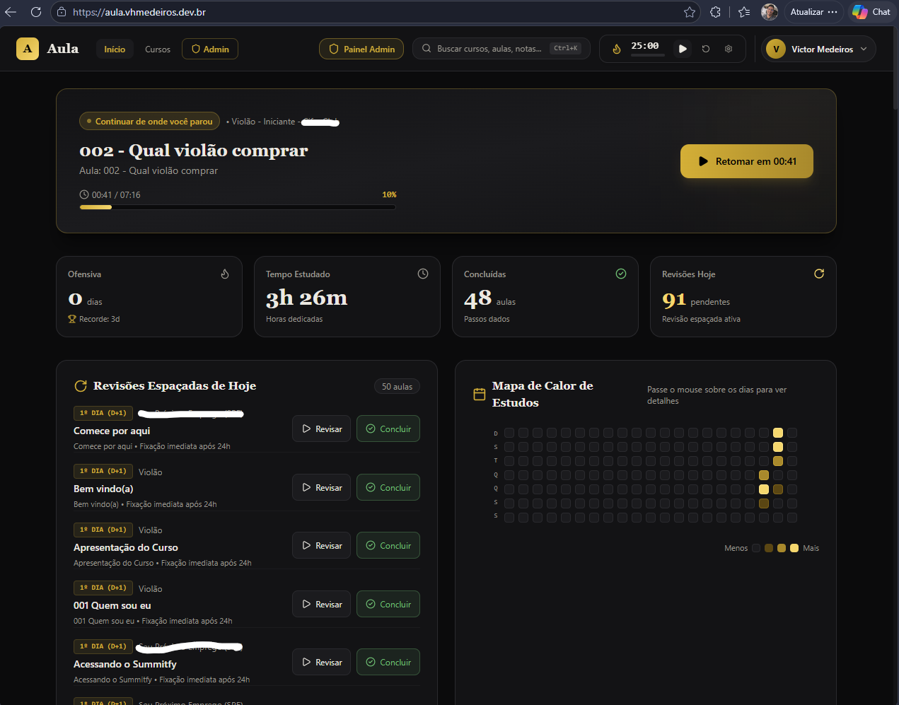
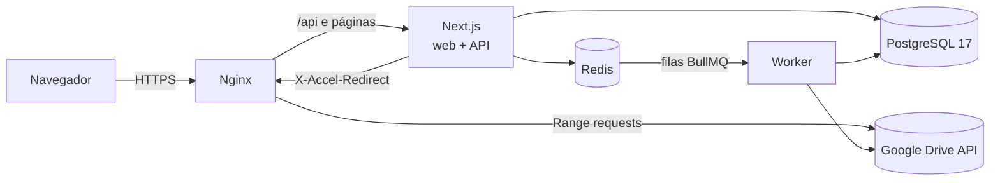

# Aula: plataforma de cursos sobre o Google Drive

Plataforma web privada de cursos em que **o conteúdo continua no Google Drive** e a aplicação é a camada de experiência: lê a pasta do curso, monta a árvore **Curso → Módulos → Aulas → Materiais** e entrega player de vídeo com seek, progresso salvo no servidor, anotações com timestamp, revisão espaçada e estatísticas de estudo. Funciona com várias pessoas e vários cursos, no desktop e no celular.

Projeto full stack feito do zero, do modelo de dados ao deploy em uma VM ARM na Oracle Cloud, com testes de integração e E2E.




---

## O problema

Cursos comprados ou recebidos costumam ficar em pastas do Google Drive com centenas de vídeos e PDFs. Assistir pelo Drive não guarda o ponto em que você parou, não mostra o que já foi concluído, não permite anotar no tempo do vídeo e não controla quem tem acesso. A Aula resolve isso sem migrar nenhum arquivo: o administrador cola o link da pasta e a plataforma faz o resto.

## Funcionalidades

**Para o aluno**

- Player de vídeo com seek instantâneo (HTTP 206), velocidade de 0,5x a 2,5x, modo teatro, tela cheia e reforço de volume até 200% (Web Audio API)
- Autoplay da próxima aula com contagem regressiva cancelável e mini-player flutuante que continua tocando ao navegar entre páginas
- **Progresso salvo no servidor**: heartbeat a cada 15 s e `sendBeacon` ao fechar a aba; reabrir retoma no segundo exato. A aula conta como concluída em 90% assistidos
- Anotações com timestamp clicável (atalho `N` pausa o vídeo e abre o editor), marcação de importantes e um **caderno do curso** exportável em Markdown
- Leitor de PDF inline que lembra a última página e modo áudio para estudar com a tela desligada
- **Revisão espaçada** (1, 7 e 30 dias) agendada ao concluir cada aula
- Sequência de estudo e heatmap de atividade no estilo do GitHub
- Paleta de comandos `Ctrl/⌘+K` com busca full-text **insensível a acentos** em cursos, aulas e anotações
- Pomodoro integrado, modo foco e atalhos de teclado para tudo (`?` mostra a lista)
- Interface responsiva com navegação inferior no celular e instalável como PWA

**Para o administrador**

- Cadastro de curso pelo link da pasta, com **pré-visualização da estrutura** antes de importar
- Sincronização em segundo plano, idempotente: o que some do Drive recebe soft delete e o progresso dos alunos nunca se perde
- Convites com token de uso único, matrículas por curso e controle de acesso por _features_

## Destaques técnicos

**Streaming sem expor credenciais.** O Next.js só autoriza: confere sessão, permissão e matrícula e responde com `X-Accel-Redirect`. Quem transmite o arquivo é o Nginx, repassando os headers `Range` para o seek funcionar. O processo Node fica livre na hora e o token da Service Account nunca chega ao navegador. Os vídeos mais assistidos ficam em um cache LRU em disco, com teto de tamanho e limpeza automática.

**Leitura do Drive como função pura.** A conversão "listagem do Drive → árvore do curso" (`services/drive/buildTree.ts`) não acessa rede nem banco, o que permite testá-la com fixtures JSON. Ela cobre ordenação natural por prefixo numérico (`001.`, `01 -`, `1_`), três estratégias para identificar aulas (por pasta, por arquivo ou automática), atalhos do Drive, arquivos soltos na raiz e pastas que devem ser ignoradas.

**Sincronização assíncrona e idempotente.** O sync roda em um worker **BullMQ** separado, com `jobId` determinístico para impedir dois syncs do mesmo curso ao mesmo tempo. Usa upsert por ID do Drive (`INSERT ... ON CONFLICT`) dentro de uma transação, e uma leitura vazia aborta o sync em vez de desativar o curso inteiro.

**Autenticação sem JWT no cliente.** Sessões em tabela própria com cookie `httpOnly`, `sameSite=lax` e expiração renovada a cada uso. Senhas com bcrypt, verificação do header `Origin` nas mutações e rate-limit no Redis contra força bruta (bloqueio progressivo após 5 erros), reforçado por `limit_req` no Nginx.

**SQL de verdade.** PostgreSQL acessado com `pg` e queries parametrizadas, migrações versionadas com `node-pg-migrate`, busca full-text com `unaccent` e a árvore do curso montada em poucas queries e cacheada no Redis.

## Arquitetura



## Stack

| Camada          | Tecnologias                                                                     |
| --------------- | ------------------------------------------------------------------------------- |
| Front-end       | Next.js 15 (Pages Router), React 19, TypeScript, Tailwind CSS v4, SWR, cmdk     |
| Mídia           | Vidstack, react-pdf (pdf.js), Web Audio API                                     |
| Back-end        | API Routes com next-connect, zod para validação, bcryptjs, nodemailer           |
| Dados           | PostgreSQL 17 (SQL puro com `pg`), node-pg-migrate, Redis                       |
| Jobs            | BullMQ em processo worker separado                                              |
| Integrações     | Google Drive API com Service Account (`google-auth-library`, retry com backoff) |
| Infraestrutura  | Docker Compose, Nginx, imagens ARM64, Oracle Cloud A1                           |
| Qualidade       | Jest (integração e unidade), Playwright (E2E desktop e mobile), GitHub Actions  |
| Fluxo de commit | ESLint, Prettier, husky, commitlint e commitizen (Conventional Commits)         |

## Testes

- **Integração (Jest):** um arquivo por rota e método em `tests/integration/api/v1/`, rodando contra o servidor real com banco limpo e migrado pelo orquestrador (`tests/orchestrator.ts`). Cobre login, bloqueio após tentativas erradas, convite de uso único, 403 para alunos em rotas de admin, 403 no streaming sem matrícula, progresso, notas, busca e revisões.
- **Unidade:** a função `buildTree` com fixtures das três estratégias de pastas.
- **E2E (Playwright):** fluxo completo do aluno (login → curso → assistir → anotar → concluir) em desktop e em viewport de celular.
- **CI:** lint e testes de integração a cada push e pull request na `main`.

```bash
npm test           # integração e unidade (sobe os serviços via Docker)
npm run test:e2e   # Playwright
```

## Como rodar localmente

Requisitos: Node 24 e Docker.

```bash
git clone https://github.com/vhmedeiros/cdf.git
cd cdf
npm install
npm run dev        # sobe Postgres, Redis e Mailcatcher, roda as migrações e inicia o Next
npm run seed       # cria um admin e um curso de exemplo com dados falsos (não precisa do Drive)
npm run worker:dev # opcional: worker de sincronização
```

A aplicação fica em `http://localhost:3000` e os e-mails de desenvolvimento em `http://localhost:1080`.

Para importar cursos reais é preciso uma Service Account do Google Cloud com a Drive API habilitada e a pasta compartilhada com o e-mail dela (permissão de leitor). As variáveis de produção estão listadas em `.env.example`.

## Estrutura

```
infra/       banco, migrações, controller, erros, Redis, filas, Nginx e scripts de deploy
models/      regras de negócio e SQL (user, session, course, progress, note, review...)
services/    integração com o Google Drive (cliente, buildTree, cache de mídia)
worker/      processo BullMQ e jobs de sincronização
pages/       telas e API REST versionada em pages/api/v1
components/  player, árvore do curso, home, busca e layout
tests/       integração, unidade e E2E
```

## Próximos passos

Em desenvolvimento em branch separada: um **banco de questões de concursos** integrado às aulas, com extração de provas em PDF (Docling), classificação por assunto e explicações geradas por IA (Gemini) por trás de um roteador com controle de cota, fallback entre modelos e circuit breaker.

## Autor

**Victor Medeiros**. [GitHub](https://github.com/vhmedeiros)
