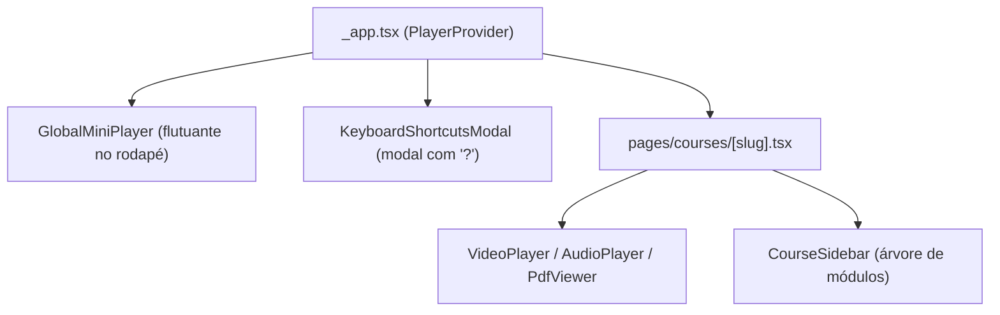

# Fase 4: Experiência de Aula (Player, Árvore de Módulos e Interface)

Bem-vindo ao guia da **Fase 4**! Se nas fases anteriores construímos os alicerces invisíveis (banco de dados, autorizações, leitura recursiva do Google Drive e streaming HTTP 206), aqui construímos a **experiência viva do aluno**: a sala de aula digital com tema **"Biblioteca Noturna"**, player de mídia versátil, árvore lateral de aulas com busca, mini-player flutuante global e atalhos de teclado completos.

---

## 1. O que foi construído nesta fase?

1. **Design System "Biblioteca Noturna" (Tailwind CSS v4 + Tokens CSS):**
   - Cores noturnas requintadas: fundo profundo (`#0b0b0c`), superfícies elevadas (`#131315`), bordas sutis (`#2a2a2e`) e toques dourados (`#d4af37` e `#f5d76e`).
   - Tipografia de alta legibilidade: serifa para títulos editoriais e algarismos tabulares (`font-variant-numeric: tabular-nums`) para tempos e contadores não tremerem na tela.
2. **Contexto de Mídia Global (`context/PlayerContext.tsx`):**
   - Um cérebro reativo único no frontend que sincroniza o curso ativo, a aula atual, a velocidade de reprodução (0.5x a 2.5x), o volume, o modo teatro, o modo áudio e os materiais concluídos.
3. **Player de Vídeo Inteligente (`components/player/VideoPlayer.tsx`):**
   - Transmissão direta via `/api/v1/stream/[id]` com suporte a seek por Range Requests.
   - Detecção automática de rolagem via `IntersectionObserver`: se o aluno rolar para baixo lendo notas, o vídeo vira automaticamente um **mini-player flutuante** no canto inferior direito!
   - **Autoplay com contagem regressiva de 5 segundos cancelável**: ao terminar um vídeo, exibe uma sobreposição com botão "Assistir agora" ou "Cancelar".
4. **Árvore Lateral de Módulos e Aulas (`components/course/CourseSidebar.tsx`):**
   - Módulo → Aula → Materiais (Vídeo, PDF, Áudio, Arquivos).
   - Indicadores visuais de progresso (barra dourada contínua, percentual e contagem $x/y$).
   - Ações de "Expandir tudo" / "Recolher tudo" e busca em tempo real.
   - Rolagem automática suave até a aula em reprodução.
   - Responsividade: no celular vira um drawer lateral retrátil.
5. **Leitor de PDF Inline (`components/player/PdfViewer.tsx`):**
   - Integração com `react-pdf` (baseado no motor pdf.js).
   - Lembra automaticamente a última página lida via `localStorage`.
   - Controles de zoom, paginação direta e download do arquivo.
6. **Modo Áudio / Podcast (`components/player/AudioPlayer.tsx`):**
   - Interface minimalista e elegante focada em escuta para quem estuda no trânsito ou prefere apenas áudio.
7. **Atalhos de Teclado Globais (`hooks/useShortcuts.ts` e modal `?`):**
   - `Espaço / K`: Play / Pause.
   - `← / →`: Voltar / Avançar 5s.
   - `J / L`: Voltar / Avançar 10s.
   - `Shift + N`: Próxima aula.
   - `Shift + P`: Aula anterior.
   - `T`: Alternar modo teatro.
   - `F`: Alternar tela cheia.
   - `[` / `]`: Diminuir / Aumentar velocidade.
   - `A`: Alternar modo áudio.
   - `?`: Exibir guia visual de atalhos.

---

## 2. Analogia com o Django: Templates vs Single Page Application (SPA)

No Django clássico, a arquitetura típica para uma tela seria:

```
[Navegador] --- (GET /cursos/direito/) ---> [Django View]
                                                ↓
                                      consulta models no ORM
                                                ↓
                                      render(request, "aula.html", context)
                                                ↓
[Navegador] <--- (HTML completo renderizado no servidor)
```

### O problema do modelo tradicional em plataformas de streaming:

Se cada clique na barra lateral para mudar de aula fizer um recarregamento de página tradicional do Django (`<a href="...">`), acontecem três problemas graves:

1. **O vídeo é destruído e recriado**: a tela pisca em branco, o buffer é descartado e o áudio é cortado.
2. **O mini-player flutuante é impossível**: não tem como um vídeo continuar tocando no canto da tela se a página inteira está sendo descarregada da memória para carregar outra URL.
3. **Estado volátil perdido**: o menu expandido, o termo digitado na busca e a posição do leitor de PDF seriam resetados.

### Como fazemos no Next.js com React:

No Next.js (Pages Router):

- O servidor entrega a casca inicial da página com HTML e CSS rápidos.
- O React "hidrata" a aplicação no navegador e assume o roteamento no cliente.
- Ao clicar em outra aula, **nenhuma página é recarregada**: apenas o estado `activeMaterial` é alterado no JavaScript, trocando a fonte do player em milissegundos sem piscar a tela!

---

## 3. O que é o `PlayerContext`? (O "Context Processor" reativo do frontend)

No Django, você conhece os `context_processors`: funções que injetam variáveis globais em todos os templates (como `request.user` ou `request.session`).

No React, o **React Context** (`createContext` + `useContext`) cumpre um papel similar, mas com um superpoder: **ele é reativo em tempo real**.



### Por que isso é revolucionário para a experiência?

1. O `PlayerProvider` fica montado no arquivo raiz `pages/_app.tsx`.
2. Se o aluno estiver assistindo a uma aula e navegar para outra página da plataforma, o player não é desmontado!
3. O `GlobalMiniPlayer` detecta que a aula ainda está tocando e continua a reprodução em miniatura no canto da tela, exatamente como o YouTube e a Netflix fazem.

---

## 4. O perigo do SSR no Node.js: `document is not defined` e `next/dynamic`

Um dos maiores choques para quem vem de linguagens puramente backend (Python/Django) ao trabalhar com Next.js é que **o código do frontend roda duas vezes**:

1. Primeiro no **servidor Node.js** (Server-Side Rendering) para gerar o HTML inicial.
2. Depois no **navegador do usuário** (Client-Side Hydration).

### O problema:

Bibliotecas multimídia como o motor do PDF (`pdfjs-dist`) ou Web Components de vídeo dependem diretamente de APIs que **só existem no navegador**, como `window`, `document`, `HTMLVideoElement` e `canvas`.

Se você der um `import PdfViewer from "@/components/player/PdfViewer"` estático no topo da página, o Node.js tentará executá-lo no servidor e disparará imediatamente um erro fatal:
`ReferenceError: document is not defined`.

### A solução: `next/dynamic` com `{ ssr: false }`

Usamos importação dinâmica assíncrona:

```typescript
import dynamic from "next/dynamic";

const VideoPlayer = dynamic(() => import("@/components/player/VideoPlayer"), {
  ssr: false,
  loading: () => <div className="skeleton">Carregando player...</div>,
});
```

- **No servidor:** o Next.js apenas renderiza o esqueleto de carregamento (sem quebrar o Node).
- **No navegador:** o componente completo é baixado sob demanda e ganha vida instantaneamente.
- **Bônus de performance:** o bundle JavaScript inicial fica ultra-leve (cerca de 119 kB), garantindo notas altíssimas no Google Lighthouse.

---

## 5. Como os Atalhos de Teclado não atrapalham formulários

Imagine que o usuário esteja digitando uma anotação ou buscando uma aula e pressione a tecla `Espaço` ou `K`. Se o atalho não for cuidadoso, o vídeo vai pausar enquanto ele digita uma frase!

Em `hooks/useShortcuts.ts`, implementamos uma verificação defensiva de foco:

```typescript
const target = event.target as HTMLElement | null;
if (
  target &&
  (target.tagName === "INPUT" ||
    target.tagName === "TEXTAREA" ||
    target.tagName === "SELECT" ||
    target.isContentEditable)
) {
  return; // O usuário está escrevendo texto: não dispare nenhum atalho!
}
```

Isso garante que o usuário tenha atalhos de alta produtividade sem jamais ter conflitos durante a digitação.

---

## 6. Resumo das Decisões de Arquitetura

| Funcionalidade            | Como foi resolvido                        | Por quê                                                                            |
| :------------------------ | :---------------------------------------- | :--------------------------------------------------------------------------------- |
| **Estilos & Cores**       | Tailwind v4 + `styles/tokens.css`         | Manutenção centralizada das cores da "Biblioteca Noturna" em CSS variables nativas |
| **Persistência de Mídia** | `PlayerContext` no `_app.tsx`             | Mini-player sobrevive à navegação entre rotas                                      |
| **Detecção de Scroll**    | `IntersectionObserver`                    | Transforma o vídeo em mini-player flutuante quando menos de 20% estiver visível    |
| **Biblioteca de PDF**     | `react-pdf` com worker isolado            | Visualização de apostilas sem abrir abas externas e lembrando a página             |
| **Autoplay de Aula**      | `setInterval` de 5s com estado cancelável | Dá autonomia ao aluno para pausar ou deixar fluir                                  |
| **Loop de TimeUpdate**    | Separação `onTimeProgress` vs `seekTo`    | Evita que o evento de progresso execute seek contínuo e esvazie o buffer de áudio  |
